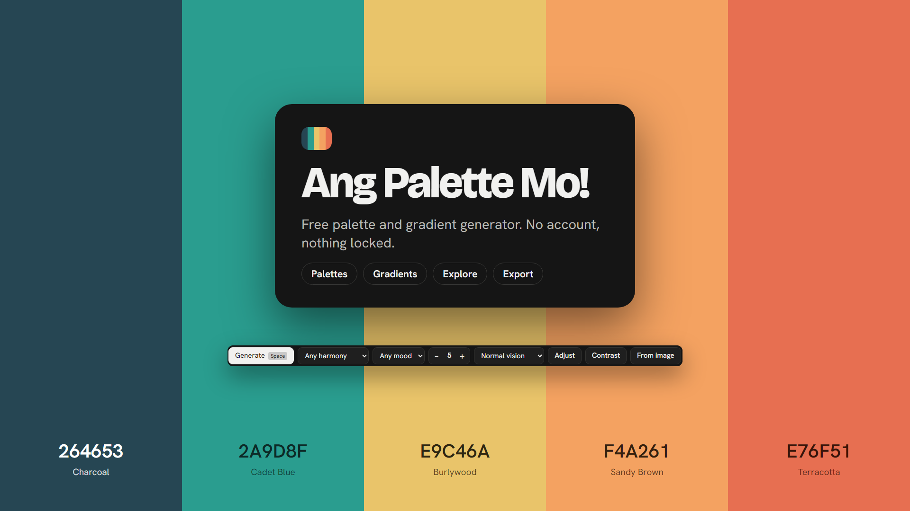
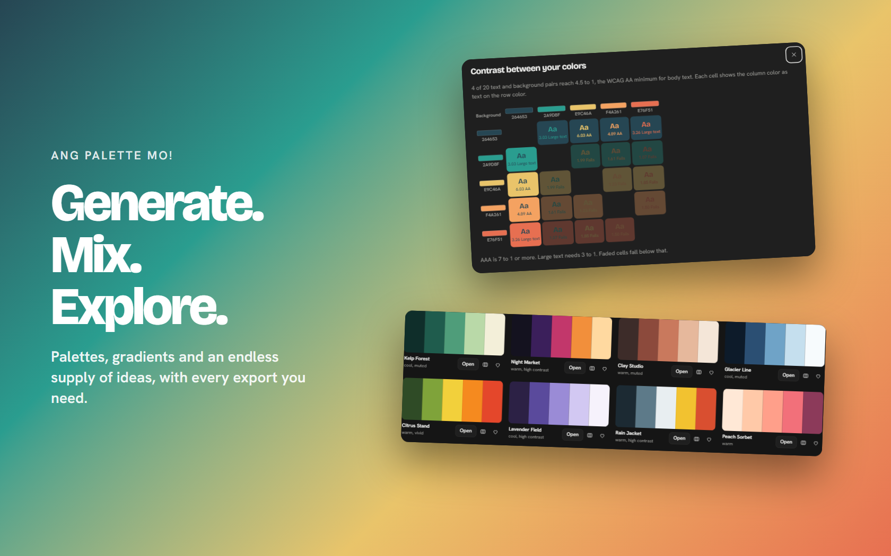

# Ang Palette Mo!

**Free palette and gradient generator.**

## About

Ang Palette Mo! makes color palettes and gradients, and gives you an endless supply of ready-made ones to explore.

It is free, with no account, and nothing is locked. Everything you make can be exported.

**[Try it: direkjames.github.io/ang-palette-mo](https://direkjames.github.io/ang-palette-mo/)**

## Features

**Palettes**
- Press **Space** to generate a new palette, with 2 to 10 colors
- Pick a color harmony (analogous, monochrome, complementary, split complementary, triadic or square) and a mood (pastel, vivid, muted, dark or light)
- Lock the colors you like and keep generating the rest
- Adjust a palette, or build one **from an image**
- Preview it with color blindness (protanopia, deuteranopia, tritanopia or greyscale)
- A **contrast checker** that grades every text and background pair against the WCAG guidelines
- Undo and redo

**Gradients**
- Linear, radial and conic gradients with as many color stops as you add
- Set the angle, drag the color stops, reverse them or space them evenly
- Choose how colors mix: OKLab, OKLCH, sRGB or HSL
- Copy the CSS, download a PNG, or copy a link to share it
- Turn a gradient into a palette, or a palette into a gradient

**Explore**
- Hand-picked palettes first, then an endless supply as you scroll
- Search by a word or a hex code, and filter by size, color or style
- Click any color to copy it

**Save and export**
- Save as many palettes and gradients as you like, and download a backup
- Export as CSS, SCSS, Tailwind, JSON, a plain list or a link
- Download as PNG, SVG, ASE (Photoshop, Illustrator and InDesign) or GPL (GIMP and Inkscape)
- Light and dark mode

## Getting started

1. Open [direkjames.github.io/ang-palette-mo](https://direkjames.github.io/ang-palette-mo/) in your browser.
2. Press **Space** (or **Generate**) until you find a palette you like.
3. Open **Gradients** to mix them, or **Explore** to browse more.
4. Press **Save** to keep it, or **Export** to take it with you.

To run it on your own computer, download this project and open `index.html`. There is nothing to install.

## Requirements

- A modern web browser (Chrome, Edge, Firefox or Safari)
- An internet connection the first time, to load the fonts

## Built with

- HTML, CSS and JavaScript in a single file, with no build step
- [Google Fonts](https://fonts.google.com): Bricolage Grotesque and Hanken Grotesk

## Status

Shipped.

## Credits / License

Made by [direkjames](https://github.com/direkjames).

All rights reserved. See [LICENSE](LICENSE).
